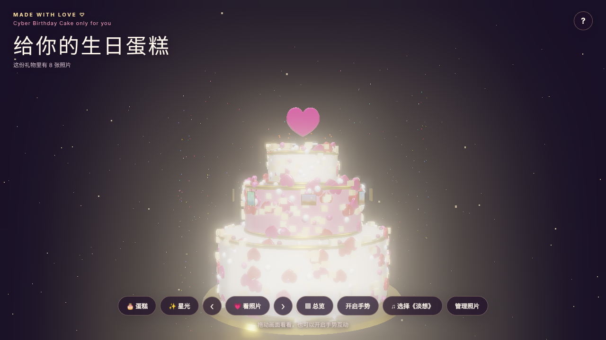
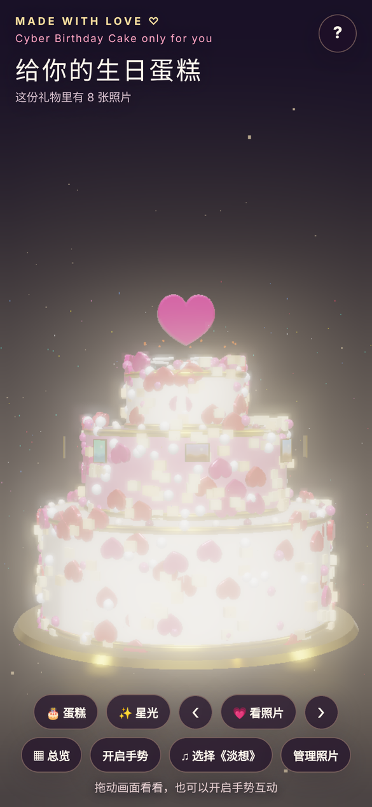
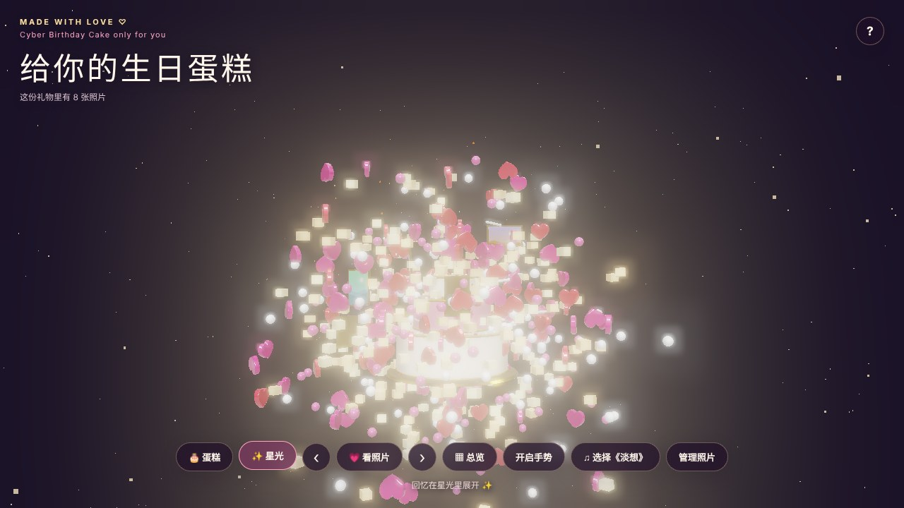
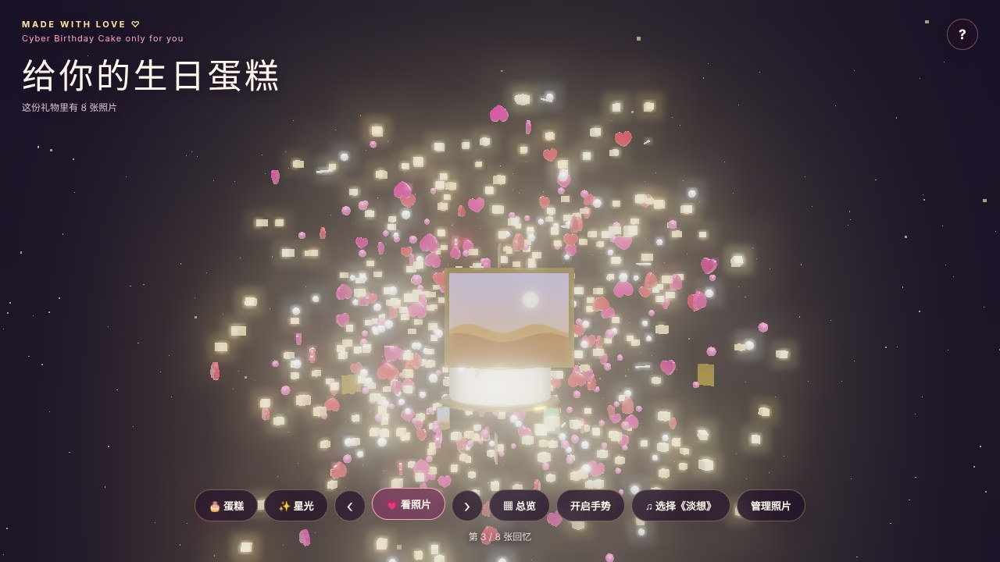
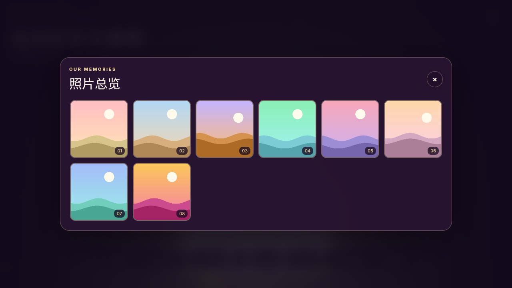

# 🖐️ 手势驱动的 3D 记忆相册 · Gesture Memory Gallery

基于 Three.js 和 MediaPipe 的浏览器端 3D 互动相册：用手势散开照片、捏合放大、挥手旋转，照片只保存在本地，最终可以打包成一个 HTML 文件直接发给别人。


<p align="center">
  
  
</p>

| ✨ 星光：照片散开 | 💗 看照片：聚焦单张 | ▦ 总览：一次看全部 |
| --- | --- | --- |
|  |  |  |

<sub>截图中的照片为示意图，真实照片只保存在本地。</sub>

## 为什么做

最初是送给妹妹的生日礼物。我没有把它做成普通的静态页面，而是定了三个体验目标：

- **仪式感**：打开时是一个由粒子组成的 3D 生日蛋糕，照片藏在蛋糕里
- **个性化**：可以放入自己的照片和音乐
- **不用鼠标也能玩**：对着摄像头做手势就能浏览照片

## 手势交互

| 手势 | 效果 |
| --- | --- |
| ✋ 张开手 | 照片从蛋糕中散开 |
| ✊ 握拳 | 照片收回，回到蛋糕 |
| 👉 移动手掌 | 光标指向想看的照片 |
| 🤏 捏合拇指和食指 | 放大当前照片，松开返回 |
| 👋 左右挥动手掌 | 转动整个场景 |

没有摄像头也没关系：按钮、左右箭头和触屏拖动能完成全部操作，"总览"可以一次看到所有照片。

## 技术实现

- **3D 场景**：用 Three.js 把蛋糕、蜡烛、火焰、彩纸和照片统一抽象成粒子对象，通过 `CAKE` / `SCATTER` / `FOCUS` 三种状态管理每个粒子的目标位置、缩放和旋转
- **手势识别**：接入 MediaPipe HandLandmarker，在浏览器端实时识别 21 个手部关键点，GPU 不可用时自动退回 CPU
- **防抖设计**：
  - 判断阈值按掌宽归一化，离摄像头远近不影响识别
  - 捏合、悬停和姿势切换都需要连续多帧确认，并设置切换冷却时间，避免误触
  - 挥手旋转对位移做平滑处理，并忽略过小的抖动和过大的跳变
- **本地优先**：照片经 Canvas 压缩后存在浏览器本地（localStorage），不上传任何服务器

## 本地运行

```bash
npm install
npm run dev
```

手势识别首次加载需要联网下载模型；照片、场景和手动操作都不依赖摄像头。

## 打包成礼物文件

私人照片、音乐和生成的礼物文件都只保存在本地，已被 Git 忽略，不会上传到这个公开仓库。

```bash
npm run export:standalone
```

`export:standalone` 会在本地生成 `Cake.html`。照片取自本地 `preset-photos/manifest.json` 所列的压缩图片；要从本地相册制作这些副本，可运行 `python scripts/prepare-preset-photos.py --source "照片文件夹"`。如果将可用音频放在本地 `preset-audio/danxiang.mp3`（或 `.m4a`、`.wav`），打包脚本也会将它嵌入 `Cake.html`。

- 双击生成的 `Cake.html`，选好照片后点"管理照片"可以加入、清空或恢复内置照片，不会删除原相册文件。
- 在制作模式点"保存礼物文件 ↗"，浏览器会下载 `送给妹妹-生日蛋糕.html`。这个单文件带有当时选好的照片和音乐，可以直接发给收礼人，双击就能看。
- 没有提供音乐文件时，页面里的"选择《淡想》"会打开本地文件选择器。要把**周童《淡想》**内置到发送版，在制作模式点"管理照片 → 选择音乐文件"，选择 MP3、M4A 或 WAV，再保存礼物文件。收礼人点击"打开这份礼物"后会尝试播放，音乐按钮可以暂停或继续。

## 后续计划

- 部署到 GitHub Pages，提供在线演示链接
- 加一个性能面板，记录粒子数量、平均帧率和加载耗时
- 补一段手势操作的 GIF 演示
